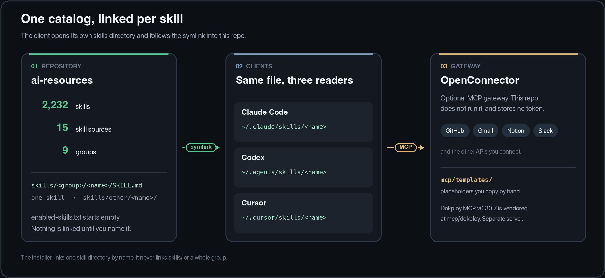
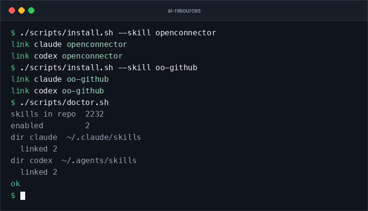

# AI resources

One Git repository for agent skills and MCP templates. Claude Code, Codex, and Cursor read the same `SKILL.md` through one symlink per skill. [OpenConnector](https://github.com/oomol-lab/open-connector) is an optional MCP gateway for GitHub, Gmail, Notion, Slack, and other APIs. This repo holds the skill files and the gateway templates. It does not store tokens, and it does not run the gateway.

It replaces hand-copied skills under `~/.claude`, `~/.agents`, `~/.cursor`, and the older `~/.codex` path. A project keeps its own `AGENTS.md`, `CLAUDE.md`, and `.cursor/rules`. This hub is not copied into those repos.

<!-- Snapshot badges match the 2026-11-12 fetch. Refresh skills, skill sources, and the diagram when docs/skills-index.md or docs/versions.md change. Live badges: security scan, last update. -->

[](https://github.com/Archon-/ai-resources/actions/workflows/skill-security.yml)
[](https://github.com/Archon-/ai-resources/actions/workflows/skill-updates.yml)
[](https://github.com/Archon-/ai-resources/commits/main)
[](docs/skills-index.md)
[](docs/sources.md)
[](mcp/README.md)
[](docs/architecture.md)



## Install

macOS or Linux. The animation is a shortened session: the `link` lines are what `install.sh` prints, and `doctor` also prints paths, binaries, and a Cursor note.



```bash
git clone https://github.com/Archon-/ai-resources.git
cd ai-resources
./scripts/install.sh --skill openconnector
./scripts/doctor.sh
```

`enabled-skills.txt` ships with no names. `./scripts/install.sh` with no arguments links only that list, so a plain install links nothing. `--skill` adds one skill and leaves the others alone. The link is the skill directory, named after the skill:

```text
~/.claude/skills/openconnector -> <this-repo>/skills/other/openconnector
~/.agents/skills/openconnector -> <this-repo>/skills/other/openconnector
```

The installer does not link `skills/` or a whole group. Clients only look one level down, and `SKILL.md` would sit one directory too deep. It does not replace a real folder or someone else's symlink, and it does not edit `CLAUDE.md`, `AGENTS.md`, or MCP settings.

Link one skill from a large catalog without taking the rest of it:

```bash
./scripts/install.sh --skill oo-github
./scripts/install.sh --skill design-system
```

Link every skill except the two largest catalogs (about 45k tokens of descriptions instead of about 134k):

```bash
./scripts/install.sh --skip-source oomol --skip-source ecc
```

Do not combine `--skill` and `--skip-source` in one command. `--dry-run` prints the links and changes nothing. To rehearse against an empty home directory, set `AI_RESOURCES_HOME` to a temp directory. Full steps: [docs/installation.md](docs/installation.md).

## Catalog

2,232 skills in 9 groups, fetched 2026-11-12. Pins, licenses, and commits are in [docs/versions.md](docs/versions.md). Every skill is listed in [docs/skills-index.md](docs/skills-index.md).

| Group | Skills | Upstream |
| --- | ---: | --- |
| `oomol` | 1,707 | [oomol-lab/skills](https://github.com/oomol-lab/skills) |
| `ecc` | 314 | [affaan-m/ECC](https://github.com/affaan-m/ECC) |
| `openmontage` | 92 | [OpenMontage](https://github.com/OpenMontageInc/OpenMontage) · AGPL-3.0 |
| `marketingskills` | 53 | [marketingskills](https://github.com/coreyhaines31/marketingskills) |
| `agent-skills` | 25 | [addyosmani/agent-skills](https://github.com/addyosmani/agent-skills) |
| `anthropics` | 20 | [anthropics/skills](https://github.com/anthropics/skills) |
| `other` | 8 | One skill per source, including local `openconnector` |
| `ui-ux-pro-max` | 7 | [ui-ux-pro-max-skill](https://github.com/nextlevelbuilder/ui-ux-pro-max-skill) |
| `ponytail` | 6 | [dietrichgebert/ponytail](https://github.com/dietrichgebert/ponytail) |

A source with one skill lives in `skills/other/<name>/`. The other groups are `skills/<source>/<name>/`.

## Clients

| Client | Where the installer links | MCP config |
| --- | --- | --- |
| Claude Code | `~/.claude/skills/<name>` | `claude mcp add` — [docs/claude-code.md](docs/claude-code.md) |
| Codex | `~/.agents/skills/<name>` | `codex mcp add` — [docs/codex.md](docs/codex.md) |
| Cursor | `~/.cursor/skills/<name>` when Cursor is installed | `~/.cursor/mcp.json` — [docs/cursor.md](docs/cursor.md) |
| ChatGPT web and desktop | Not linked | Not automatic — [docs/chatgpt.md](docs/chatgpt.md) |

With no harness flag, install links every harness it finds on this machine. A harness counts as installed when its binary is on `PATH`, or its config directory holds more than skill-drop folders (`skills`, `rules`). Claude Code, Codex, and Cursor are the usual set.

Cursor's global directory is `~/.cursor/skills/<name>`. The symlink works in the local app. Cursor Cloud Agents skip symlinked skill folders, so this hub's links stay on this machine. Cursor also reads `~/.claude/skills` and `~/.agents/skills`, so the same skill can show up more than once. `doctor` reports that. `--cursor`, `--claude-code`, or `--codex` limits the link to one harness. The other eleven are listed in [docs/installation.md](docs/installation.md). `--clients claude,codex` still works.

## Keep a set of skills

Commit `enabled-skills.txt` when the same set should follow you to another machine. Tokens stay in the client config on that machine.

Update:

```bash
git pull
./scripts/fetch-sources.sh   # only when refreshing vendored upstream skills
./scripts/sync.sh            # relink whatever enabled-skills.txt still lists
```

`sync.sh --dry-run` prints link and unlink actions and changes nothing. A name removed from `enabled-skills.txt`, or a folder removed from `skills/`, loses its symlink on sync. Fetch reclones the pinned upstream repos and keeps skills marked `"managed": "local"`. It overwrites vendored files, including local edits inside those folders.

Remove one skill, or every symlink this repo created:

```bash
./scripts/uninstall.sh --skill oo-github
./scripts/uninstall.sh
```

Uninstall does not delete skills inside the repo, and it does not touch a skill installed some other way.

Add a skill you wrote under `skills/other/<name>/SKILL.md`. Record it in `docs/skill-origins.json` with `"managed": "local"`, or the next fetch deletes it. Then `./scripts/install.sh --skill <name>`.

Review a third-party skill before vendoring it. [skills.sh](https://skills.sh/) and `npx skills add` are fine for discovery. Copy the skill into `skills/other/<name>/`, record the URL and commit in [docs/sources.md](docs/sources.md), then install that one name. Details: [docs/installation.md](docs/installation.md).

## OpenConnector

Point each client at the same server. Templates with placeholders, not real tokens, are in `mcp/templates/`. The skill that teaches the tool sequence is `skills/other/openconnector`. It does not open the connection. Steps: [docs/openconnector.md](docs/openconnector.md).

Dokploy MCP `v0.30.7` is vendored at `mcp/dokploy`. It is a server you can run. It is not part of the OpenConnector setup. See [mcp/README.md](mcp/README.md).

## Pipelines

Two GitHub Actions workflows. Both use the Python on the runner. No extra packages. Detail: [docs/pipelines.md](docs/pipelines.md).

| Workflow | When | What fails or gets flagged |
| --- | --- | --- |
| [Skill security](.github/workflows/skill-security.yml) | Every pull request, every push to `main`, Monday 07:00 UTC | `python3 scripts/scan_skills.py` finds a live secret, or a URL piped into a shell |
| [Skill updates](.github/workflows/skill-updates.yml) | Monday 08:00 UTC, and when started by hand | `python3 scripts/check_updates.py` finds a newer same-prefix tag, or a moved branch tip, and opens a "Skills to update" issue |

The security badge above is the latest run on `main`. The upstream-pins badge is the schedule, not a pass/fail result. That workflow does not run on pull requests. A clean Monday run closes the update issue. Upstream being ahead does not fail the job.

## Limits

- ChatGPT's chat UI does not read this repo. Codex does. Those are different products. See [docs/chatgpt.md](docs/chatgpt.md).
- About 2,200 skills ship vendored. Clients load the name and description for each linked skill. Skip sources you do not want linked.
- OpenMontage skills are AGPL-3.0 (`upstream/openmontage/LICENSE`). Other sources keep their own licenses, listed in [docs/versions.md](docs/versions.md).
- Symlinks are a macOS and Linux mechanism. Windows needs Developer Mode or a different link type. That is not set up here.
- The linker was tested against a temporary home directory. It has not been run inside Claude Code, Codex, or Cursor.

## Documentation

| Doc | Covers |
| --- | --- |
| [Proposed architecture](docs/architecture.md) | How the symlinks and the gateway fit together |
| [Installation and sync](docs/installation.md) | Flags, conflicts, vendoring, another machine |
| [Sources](docs/sources.md) | What was copied, and what was left upstream |
| [Skills index](docs/skills-index.md) | All 2,232 skills |
| [Versions](docs/versions.md) | Tag, commit, and license for each pin |
| [Pipelines](docs/pipelines.md) | What the scanners match |
| [MCP](mcp/README.md) | Templates, catalogs, and the Dokploy server |
